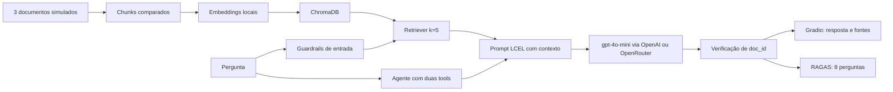

# CitizenTech Mobilidade — Aurora do Vale

Protótipo acadêmico de assistente para a linha 714 de **Aurora do Vale, município fictício**. Todos os documentos municipais deste projeto são simulações originais; não descrevem um serviço público real. Turma **1CCR**, trio Sergio Augusto (RM 570184), Gabriel Freitas (RM 572943) e Giovanni Merlotti (RM 573721).

## Estado da entrega

O notebook, os documentos, as ferramentas, a interface, os guardrails e a rotina de avaliação estão implementados. As oito respostas de referência escritas e revisadas pelo trio em 12/11/2026 foram inseridas na seção 7 e conferidas com a base simulada. Em 19/11/2026, o `Run all` no Google Colab concluiu sem erros e mediu **32 de 32 scores RAGAS** com `gpt-4o-mini` via OpenAI; o notebook e o JSON deste ZIP são dessa execução. Uma execução local anterior, em 16/11/2026, gerou os sete PNGs de evidência e os números citados no vídeo. O desenvolvimento e os testes usaram o OpenRouter gratuito (o Ollama Cloud pedido no briefing não estava utilizável), mas o limite diário do plano gratuito impediu concluir as 32 métricas a tempo; por isso a medição final foi feita na OpenAI. O JSON está em `status: medido`. O uso de IA no projeto está descrito em [6_Chat_Log.txt](6_Chat_Log.txt).

## Fluxo

O itinerário `AV-MOB-001` (20/10/2026) descreve o P07 como acessível. A portaria `AV-MOB-003` (06/11/2026) o interdita a partir de 07/11/2026 e indica o P09, com rampa e piso tátil, como alternativa. Essa é a armadilha temporal. A localização exata e a acessibilidade do P09 aparecem no corpo do itinerário, depois do primeiro parágrafo. A tabela `AV-MOB-002` (22/10/2026) contém as partidas do Terminal Central e não foi revogada pela portaria.

`2_base_documental/fixture_injection_teste.md` é uma entrada externa simulada para o teste de segurança. Não é documento municipal e não é indexada; o notebook remove a instrução maliciosa antes de apresentar seu conteúdo ao modelo.

## Reproduzir no Colab

1. Abra o [notebook no Google Colab](https://colab.research.google.com/drive/1WdDshf1cbZoeAy6SdYazyYqDxyqwxibA?usp=sharing) ou envie `1_Notebook_GS2026_2.ipynb` para o Colab. O notebook recria os três documentos caso a pasta ainda não exista; se a pasta for enviada, ele confere que os textos são idênticos.
2. Cadastre **uma** chave nos **Secrets** do Colab e dê acesso ao notebook: `OPENAI_API_KEY` (OpenAI), `OPENROUTER_API_KEY` (OpenRouter) ou `API_KEY` (genérica: chaves `sk-or-` vão para o OpenRouter, as demais para a OpenAI ou para `API_BASE_URL`, se cadastrada). O modelo padrão é `gpt-4o-mini` (`openai/gpt-4o-mini` no OpenRouter); o secret opcional `MODEL_ID` troca o modelo, por exemplo `openrouter/free`. As chaves são lidas com `userdata.get(...)`; nunca as cole em célula, print, ZIP ou repositório. Se o `3_avaliacao_ragas.json` enviado tiver sido medido com outro modelo, o notebook guarda essa medição em `3_avaliacao_ragas_anterior.json` e mede de novo, sem misturar execuções.
3. As oito respostas de referência do trio estão na lista `REFERENCIAS_MANUAIS` da seção 7.
4. Execute **Runtime → Run all**. A instalação usa versões diretas fixadas: `langchain-core 1.7.7`, `langchain-openai 1.7.4`, `langchain-community 0.3.31`, `chromadb 1.5.9`, `sentence-transformers 6.2.0`, `gradio 6.31.0` e `ragas 0.4.3`. A execução requer acesso de rede para instalar pacotes, baixar o embedding e consultar o provedor do modelo (OpenAI ou OpenRouter). A execução local de 16/11/2026 concluiu as demonstrações e as 32 métricas; o `Run all` no Colab foi concluído sem erros pelo trio em 19/11/2026.
5. A seção 7 salva cada resposta e métrica concluída em `3_avaliacao_ragas.json`. Se uma chamada falhar, preserve o JSON parcial e retome com o mesmo arquivo: o notebook confere perguntas, referências, modelo e chunking. Baixe o notebook executado e o JSON medido para a pasta da entrega. Depois disso, não execute `build_notebook.py`, pois ele recria o notebook inicial e apaga as saídas da execução.
6. Os sete PNGs gerados localmente estão em `2_base_documental/evidencias/`. As imagens de saída foram renderizadas a partir dos logs executados; a interface Gradio foi capturada no navegador com duas perguntas, histórico e fontes. O carregador do notebook lê apenas `doc_*.md` da raiz da pasta, portanto as imagens não entram no índice.
7. Após preencher certificação e link do vídeo, rode `python package_submission.py`. O script verifica os itens finais e cria `GS2026_2_1CCR_AuroraDoVale.zip`.

### Teste local com `.env`

Para rodar localmente, preencha **apenas no seu computador** `OPENAI_API_KEY=`, `OPENROUTER_API_KEY=` ou `API_KEY=` no arquivo `.env` desta pasta. Não envie a chave no chat. O arquivo está no `.gitignore` e não entra no ZIP gerado por `package_submission.py`. Fora do Colab, o notebook lê esse `.env`; no Colab, use apenas **Secrets** e não faça upload do `.env`.

### As oito respostas de referência

A seção 7 traz **quatro perguntas simples e quatro perguntas que exigem resolver a contradição** entre documentos. `REFERENCIAS_MANUAIS` contém as oito respostas escritas e revisadas pelo trio, na mesma ordem dessas perguntas. Elas foram conferidas com a base simulada e inseridas no notebook com auxílio de IA. Elas servem de referência para o RAGAS comparar o que foi recuperado e respondido. Os resultados numéricos só podem vir da execução real.

| Pergunta na lista | Documentos que o trio deve conferir |
|---|---|
| 1 — bairros atendidos | `AV-MOB-001`, início do texto |
| 2 — partidas de domingo | `AV-MOB-002`, tabela de horários |
| 3 — localização do P09 | `AV-MOB-001`, último parágrafo |
| 4 — acessibilidade do P09 | `AV-MOB-001`, último parágrafo |
| 5 — estado do P07 em 11/11 | `AV-MOB-001` e `AV-MOB-003`, conferindo a vigência |
| 6 — atendimento do Jardim Ipê aos domingos | `AV-MOB-001`, `AV-MOB-002` e `AV-MOB-003` |
| 7 — alternativa acessível ao P07 | `AV-MOB-001` e `AV-MOB-003` |
| 8 — efeito da portaria sobre horários | `AV-MOB-002` e `AV-MOB-003` |

Este mapa indica as fontes usadas para conferir as respostas de referência.

### Decisões técnicas

- Dois chunkings são comparados: 500 caracteres com sobreposição de 80 e 850 com sobreposição de 120. A escolha ocorre pelo teste da armadilha; em empate, vence o que criar menos chunks. O resultado efetivo será registrado na saída do notebook.
- O retriever usa `k=5`. Para perguntas sobre a linha ou P07, a portaria posterior é acrescentada ao contexto se a busca semântica não a tiver trazido; isso evita ignorar a alteração vigente. Cada trecho exibe `doc_id` e data.
- Embeddings locais multilíngues (`paraphrase-multilingual-MiniLM-L12-v2`) alimentam ChromaDB e RAGAS. Respostas e juiz usam `gpt-4o-mini`. A seção 7 salva cada escore válido antes de passar ao seguinte, usa uma geração em `response_relevancy` e retoma do último checkpoint. Se ocorrer erro de rede ou limite, preserve o JSON parcial e documente quantas métricas foram realmente medidas.
- O agente tem duas ferramentas determinísticas: estado de P03/P07/P09 em uma data e próxima partida da linha 714 em dia útil, sábado ou domingo. O limite é de seis chamadas por pergunta. Perguntas compostas podem usar as duas.
- A aplicação consulta o agente e então o RAG. Em geral, há uma chamada de decisão e uma de resposta por pergunta, mais chamadas quando ferramentas são usadas. O RAGAS acrescenta chamadas do juiz por métrica e pergunta. Medir a latência e o uso na execução final.

### Limitações

Não há dados em tempo real, tarifas, feriados, previsão de passagem em pontos nem data de reabertura do P07. A regra de escopo e a remoção de linhas maliciosas são demonstrações acadêmicas, não proteção suficiente para produção. Uma implantação real exigiria dados oficiais atualizados, revisão LGPD, controle de acesso, monitoramento, avaliação recorrente e canal oficial verificável. O histórico do Gradio dura a sessão; não há persistência de conversas.

## Resultados e evidências da execução local

| Evidência | Arquivo/valor |
|---|---|
| Comparação dos chunkings; busca e distâncias | [chunking_busca.png](2_base_documental/evidencias/chunking_busca.png) |
| Três respostas com fonte e uma recusa | [respostas_fontes.png](2_base_documental/evidencias/respostas_fontes.png) |
| Ferramentas e erro controlado | [agente_ferramentas.png](2_base_documental/evidencias/agente_ferramentas.png) |
| Trace das duas ferramentas | [agente_trace.png](2_base_documental/evidencias/agente_trace.png) |
| Interface com duas perguntas, histórico e fontes | [interface_gradio.png](2_base_documental/evidencias/interface_gradio.png) |
| Quatro guardrails | [guardrails.png](2_base_documental/evidencias/guardrails.png) |
| RAGAS por pergunta e médias | [3_avaliacao_ragas.json](3_avaliacao_ragas.json), `medido`, 32/32 (Colab, 19/11); [ragas_scores.png](2_base_documental/evidencias/ragas_scores.png) mostra a execução local de 16/11 |
| Médias RAGAS (Colab, 19/11) | `faithfulness` 0,9393; `response_relevancy` 0,7717; `context_precision` 0,9104; `context_recall` 0,6771 |
| Médias RAGAS (local, 16/11, vídeo e PNG) | `faithfulness` 0,9571; `response_relevancy` 0,7786; `context_precision` 0,9104; `context_recall` 0,6667. Diferença de até 0,02 atribuída à variação do juiz LLM |
| Falha observada e melhoria concreta | Nas duas execuções, a resposta à pergunta 8 começou com “Sim”, embora a tabela não tenha sido cancelada (`faithfulness` 0,7143 no Colab). Proposta: exigir conclusão direta de sim/não e conferir a coerência da primeira frase com a fonte. |

## Checklist de envio

- [x] `Run all` completo em Colab limpo, sem erros, com as oito referências revisadas
- [x] `3_avaliacao_ragas.json` com `status: medido` e quatro métricas por pergunta na execução local
- [x] Conclusão com até 15 linhas, resultados numéricos reais e uma melhoria proposta
- [x] PNGs da execução local vinculados neste README
- [x] `5_certificacao.txt` com links finais e nomes/RMs
- [x] `6_Chat_Log.txt` revisado pelo trio
- [x] `7_demo_video_url.txt` com vídeo YouTube não listado, até 3 minutos e apresentação dos três integrantes
- [x] ZIP `GS2026_2_1CCR_AuroraDoVale.zip`, com sete entradas principais, sem chave exposta
- [ ] Envio no Portal FIAP até 19/11/2026 às 23h59
